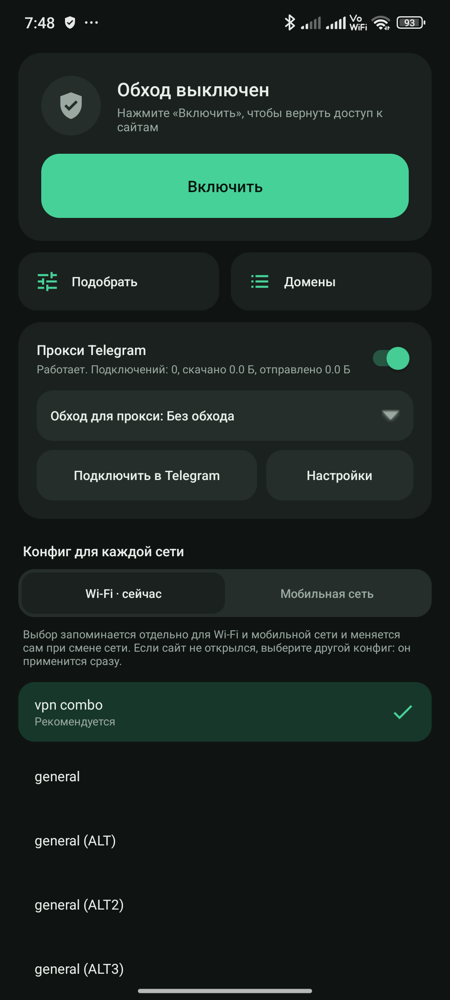

# Zapret Cap для Android

Приложение, которое возвращает доступ к сайтам и сервисам, которые замедляет или блокирует провайдер: YouTube, Discord и другим. На главном экране кнопка «Включить», список конфигов и прокси Telegram.

Для обхода сторонние серверы не нужны. VPN здесь локальный: трафик не уходит на чужой сервер, а обрабатывается прямо на телефоне. IP-адрес не меняется.



Это перенос [Zapret Cap для Linux](https://github.com/CapptainnCWC/zapret-cap) на Android. Основа проекта: стратегии [zapret-discord-youtube](https://github.com/Flowseal/zapret-discord-youtube) и движок [ByeDPI](https://github.com/hufrea/byedpi). Конфиги называются так же, как стратегии в Windows-версии. Права root не нужны.

## Установка

Понадобится телефон с Android 7 или новее.

1. Скачайте `zapret-cap.apk` со страницы [последнего релиза](https://github.com/CapptainnCWC/zapret-cap-android/releases/latest) и откройте его на телефоне.
2. Android спросит, разрешить ли установку из этого источника. Разрешите: приложения нет в Google Play, поэтому система предупреждает. Play Protect может назвать приложение незнакомым: нажмите **Подробнее → Всё равно установить**. Весь код собирается из исходников в этом репозитории.
3. Откройте приложение **Zapret Cap**.

## Как пользоваться

1. Нажмите **Включить**.
2. Android спросит разрешение на VPN. Разрешите: без него обход не запустится. Значок ключа в строке состояния означает, что обход работает.
3. Проверьте нужный сайт. Если не открылся, нажмите **Подобрать**: приложение само проверит все конфиги и выберет лучший для текущей сети. Или просто нажмите другой конфиг в списке: он применится сразу.

Для Wi-Fi и мобильной сети конфиг выбирается отдельно: они блокируются по-разному. Вкладки над списком показывают выбор для каждой сети. При смене сети конфиг меняется сам, а соединения переподключаются.

Подходящий конфиг зависит от провайдера, а со временем рабочий может перестать помогать. Это нормально: снова нажмите **Подобрать**.

**Подобрать** заменяет тест конфигураций из Windows-версии. Приложение по очереди открывает через каждый конфиг Discord, YouTube, Cloudflare, поисковики и сайты, которые вы добавили сами, и показывает, сколько открылось. Лучшие конфиги проверяются ещё раз, в счёт идёт худший результат. Конфиг, который ломает поисковики, не победит. Проверка занимает несколько минут, разрешение на VPN для неё не нужно. Экран в это время не гаснет. Если даже лучшие конфиги открыли не всё, приложение пробует другой TTL фейков и запоминает его для этой сети.

## Какие сайты обрабатываются

Кнопка **Домены** открывает три списка:

- **Обход:** к этим сайтам и их поддоменам применяется обход. Сюда добавляйте сайт, который не открывается.
- **YouTube:** домены YouTube и Google, у многих конфигов для них свои приёмы.
- **Не трогать:** эти сайты идут без изменений. Сюда добавляйте сайт, который без обхода работает, а с ним ломается.

Введите домен или вставьте адрес сайта и нажмите **+**: `https://`, `www` и путь уберутся сами. Можно вставить несколько доменов через запятую. То же поле ищет по списку. Домен находится только в одном списке: если добавить его в другой, из прежнего он уберётся. **Вернуть исходный список** отменяет ваши изменения в разделе. Изменения применяются при возврате на главный экран.

## Настройки обхода

Кнопка **Настройки обхода** внизу главного экрана. Это те функции `service.bat` из Windows-версии, которые имеют смысл на телефоне и работают без прав root.

| В приложении | В `service.bat` | Что делает |
| :--- | :--- | :--- |
| **Обход по IP-адресам (IPSet)** | IPSet Filter | **Выключен:** обход только для доменов из списков. **По списку:** ещё и для подсетей из списка zapret-discord-youtube. **Все адреса:** для всех сайтов, кроме «Не трогать» |
| **Обновить** список IPSet | Update IPSet List | Загружает свежий список подсетей с GitHub проекта |
| **Фейк для голоса Discord** | Replace active fakes | Какой пакет-обманка идёт перед голосовыми соединениями Discord |
| **Адреса из hosts** | Update Hosts File | Для Telegram, Discord и GitHub приложение отвечает адресами из списка проекта. Системный файл hosts не меняется, адреса подставляет DNS приложения |

Фильтр игр из Windows-версии не перенесён: он нужен для игр через Steam. Изменения применяются при возврате на главный экран.

## DNS

Приложение само отвечает на запросы DNS. Обычный DNS здесь не подходит: провайдер подделывает ответы, например на `www.youtube.com` от имени `1.1.1.1` приходит «такого домена нет», а в режиме белых списков у оператора `1.1.1.1` и `8.8.8.8` вообще недоступны, и браузер не находит ни один сайт. Поэтому приложение спрашивает зашифрованно (DoH) у Cloudflare и Google, а если они недоступны, у DNS Яндекса и DNS самой сети. Побеждает ответ с адресами. Запросы идут напрямую с телефона, сторонних серверов, кроме этих DNS, здесь нет.

## Белые списки на мобильном интернете

Иногда оператор оставляет доступ только к разрешённым сайтам, остальные адреса не отвечают вообще, даже без обхода. Обход здесь не поможет: блокировка идёт по адресу, а не по содержимому трафика. Приложение в этом режиме оставляет рабочими разрешённые сайты (`ya.ru`, `vk.com`, `ozon.ru` и другие), а не закрывает всё подряд. Прокси Telegram в этом режиме может не подключиться. Когда режим кончится, всё заработает само.

На Xiaomi и похожих телефонах разрешите приложению работать в фоне без ограничений: **Настройки Android → Приложения → Zapret Cap → Контроль активности → Нет ограничений** и включите автозапуск. Иначе прошивка может усыплять обход.

Чтобы обход включался сам вместе с телефоном, откройте в настройках Android раздел **Сеть и интернет → VPN → Zapret Cap** и включите **Постоянная VPN**. Название раздела зависит от телефона.

## Прокси для Telegram

Отдельная функция для случаев, когда Telegram не подключается или плохо грузит фото и видео. Она работает и без обхода: включать **Включить** для неё не нужно. Основа: [tg-ws-proxy](https://github.com/Flowseal/tg-ws-proxy).

1. Внизу экрана включите переключатель **Прокси Telegram**.
2. Нажмите **Подключить в Telegram**. Откроется Telegram и спросит, добавить ли прокси: согласитесь.

Больше ничего делать не нужно. Прокси работает в фоне, в шторке висит его уведомление, а после перезагрузки телефона он запускается сам.

При первом включении Android спросит, можно ли приложению работать в фоне без ограничений. Разрешите: иначе экономия батареи может усыплять прокси, и Telegram будет переподключаться.

Telegram запоминает этот прокси. Если выключить его только здесь, Telegram перестанет подключаться. Чтобы отказаться от прокси, сначала отключите его в самом Telegram: **Настройки → Данные и память → Настройки прокси**.

Если приложение пишет «Telegram не найден», ссылка уже скопирована: отправьте её себе в «Избранное» и нажмите на неё в Telegram. Можно добавить прокси и вручную, тип MTProto: сервер `127.0.0.1`, порт `1443`, ключ `dd` и затем ключ из настроек.

### Куда идут данные

Телефон подключается к серверам Telegram через WebSocket, а там, где это не работает, через домены на Cloudflare. Эти домены обслуживают другие люди: переписка остаётся зашифрованной протоколом Telegram, но владелец домена может видеть ваш IP-адрес и объём трафика. Свой домен можно указать в настройках: [CF-прокси](https://github.com/Flowseal/tg-ws-proxy/blob/main/docs/RU/CfProxy.md) или бесплатный [Cloudflare Worker](https://github.com/Flowseal/tg-ws-proxy/blob/main/docs/RU/CfWorker.md).

Список доменов приложение раз в час обновляет с GitHub проекта tg-ws-proxy.

### Обход для прокси

Прокси не зависит от основного обхода, как tg-ws-proxy на компьютере: конфиг, хороший для YouTube, бывает плох для Telegram. Конфиг для прокси выбирается строкой **Обход для прокси** в карточке Telegram на главном экране (тот же пункт есть в **Настройках** прокси):

- **Без обхода** (по умолчанию): прокси соединяется с Telegram и Cloudflare напрямую.
- **Конфиг из списка:** для прокси запускается отдельный движок с этим конфигом. Основной обход при этом может быть включён с другим конфигом или выключен.

### Если Telegram работает плохо

**Постоянно переподключается.**
- Проверьте, что экономия батареи не ограничивает приложение: **Настройки Android → Приложения → Zapret Cap → Батарея → Без ограничений**. На Xiaomi, Huawei, Samsung и похожих телефонах название раздела может отличаться, там же может быть отдельная настройка автозапуска.
- Если обход включён, выключите его и проверьте без него. Если стало лучше, нажмите **Подобрать**.
- Если не помогло, откройте **Настройки → Журнал**, нажмите **Скопировать** и пришлите текст разработчику. В журнале видно, какой маршрут оборвался и кто закрыл соединение. Если приложение падало, там же будет причина сбоя.

**Не грузятся фото и видео.** Откройте **Настройки** и в поле «Датацентры Telegram» оставьте только `4:149.154.167.220`. Если не поможет, очистите поле полностью и нажмите **Сохранить**.

**Не подключается вообще.** В настройках нажмите **Проверить**: приложение покажет, какие маршруты отвечают. Если обход включён, попробуйте другой конфиг. Подробности есть в разделе **Журнал**.

**Пишет, что порт занят.** Порт уже использует другое приложение. Укажите в настройках другой порт и снова нажмите **Подключить в Telegram**: Telegram должен узнать новый адрес.

## Чем отличается от Windows-версии

Приложению не нужны права root: всё работает через локальный VPN.

### Почему стратегии только близкие

Без root Android не разрешает приложениям отправлять собственные сетевые пакеты, поэтому часть приёмов из Windows-версии здесь невозможна.

- **Остаётся таким же:** фейки QUIC и Discord, разбиение TLS на те же позиции, списки сайтов.
- **Заменяется:** фейки с подделанными `ts` и `badseq` и приём `seqovl` становятся фейками с малым TTL. Такой пакет видит оборудование провайдера, но он не доходит до сайта.
- **Пропадает:** `syndata`. В конфиге ALT5 остаётся только изменение порядка сегментов.

Поэтому конфиг, рабочий в Windows, не обязательно заработает здесь, и наоборот. Подробное сравнение: [docs/PORTING.md](docs/PORTING.md).

В конце списка есть конфиги, которых нет в Windows-версии. **vpn combo** подобран по замерам на настоящих Wi-Fi и мобильной сети и выбран по умолчанию для обеих: фейк с TTL 6 для YouTube и с TTL 5 для остальных. Остальные это приёмы из ByeDPI. **vpn auto** сам переходит к следующему приёму, если соединение сбросили, а **vpn disorder**, **vpn split**, **vpn tlsrec** и **vpn oob** работают без фейков, поэтому им не мешает близкий сервер. **Подобрать** проверяет их вместе с остальными.

## Если что-то не работает

**Сайт перестал открываться у всего телефона.** Нажмите **Выключить**. Если стало лучше, причина в конфиге: выберите другой.

**Открываются не все сайты.** Обход применяется только к сайтам из списка. Добавьте нужный сайт через кнопку **Домены**.

**Сайт работает без обхода, а с обходом нет.** Добавьте его в список **Не трогать** через кнопку **Домены**.

**На мобильном интернете открываются только российские сайты.** Скорее всего, оператор включил белые списки, см. раздел выше. Проверить просто: выключите обход. Если заблокированные сайты всё равно не открываются, причина не в приложении.

**Ни один конфиг не помогает.**
- Нажмите **Подобрать**, если ещё не пробовали: там видно, сколько сайтов открывается с каждым конфигом и без обхода.
- Выключите другие VPN и программы для обхода блокировок: одновременно на телефоне может работать только один VPN.
- Попробуйте **Настройки обхода → IPSet: По списку**: обход будет работать и для адресов из списка подсетей, а не только для доменов.
- Проверьте другую сеть: мобильный интернет и домашний Wi-Fi часто блокируются по-разному.

**Сайт перестал открываться только при включённом конфиге с фейком.** Сервер может находиться слишком близко, тогда пакет с малым TTL доходит до него и ломает соединение. Попробуйте **vpn disorder** или ALT5: в них нет фейков для TCP.

## Сборка из исходников

Нужны JDK 17, Android SDK и NDK 28.2.13676358. Путь к SDK укажите в файле `local.properties`:

```text
sdk.dir=/путь/к/Android/Sdk
```

Затем соберите APK:

```bash
./gradlew assembleRelease
```

Готовый файл появится в папке `app/build/outputs/apk/release/`. Проверить конфиги VPN на компьютере с Linux можно без прав администратора:

```bash
tests/vpn-sandbox-test.sh
```

Проверки прокси Telegram тоже запускаются на компьютере:

```bash
tests/tgproxy-test.sh unit
```

Проверки на настоящем телефоне по adb запускаются скриптами из `tests/phone/`. Они живут на телефоне и переживают отключение Wi-Fi. Команды обхода из adb принимает только отладочная сборка (`./gradlew assembleDebug`), в обычную они не входят.

Без файла `keystore.properties` APK подписывается отладочным ключом. Чтобы обновления ставились поверх старой версии, подписывайте их одним и тем же ключом:

```text
storeFile=/путь/к/ключу.jks
storePassword=...
keyAlias=...
keyPassword=...
```

| Что | Где |
| :--- | :--- |
| Приложение | `app/src/main/java/org/zapretcap/app/` |
| Прокси Telegram | `app/src/main/java/org/zapretcap/tgproxy/` |
| Конфиги | `app/src/main/assets/strategies/` |
| Перевод стратегий с Windows | `tools/bat2conf.py`, `tools/bat2vpn.py` |
| Сборка движков | `native/build-native.sh` |
| Проверки | `tests/` |
| Проверки на настоящем телефоне | `tests/phone/` |

## Лицензии

Код приложения распространяется по лицензии MIT, см. [LICENSE.txt](LICENSE.txt). В APK входят сторонние компоненты с собственными лицензиями, в том числе под GPL: [THIRD_PARTY.md](THIRD_PARTY.md).
